# ThinkLess

**Ask before thinking. Then use the smallest model that does the job.**

ThinkLess is a router that sits in front of an AI assistant. For every request it decides whether the request is clear enough to answer and which Claude model it really needs: **Claude Haiku 5.5**, **Sonnet 5.5**, **Opus 5.5**, or, rarely, **Fable 5.2**. Simple questions stop being answered by the most expensive model, and a repeated question reuses its earlier answer. As a Claude Code plugin it needs **no API key**, shows a **live savings counter** in every answer, and reads Claude Code's own logs to report what it saved.

> **Just want to use it?** Read **[THINKLESS.md](THINKLESS.md)**: what it is in one paragraph, and how to install it in Claude Code.

Built in 24 hours at **CodeJam 16** (McGill University, November 2026) for the **Agent Solution** track: efficient use of compute, with a demo that shows *how* the agent decides, not just what it produces.

---

## The problem

Most AI apps send every request to their strongest model. "What is the capital of Australia?" and "Design a ride-sharing system for 50,000 users" get the same treatment and the same bill. On top of that, an assistant that misunderstands a vague request wastes a whole expensive answer.

## Why it matters

Every token a model generates runs through billions of parameters on a GPU. Doing less of that work saves four things at once.

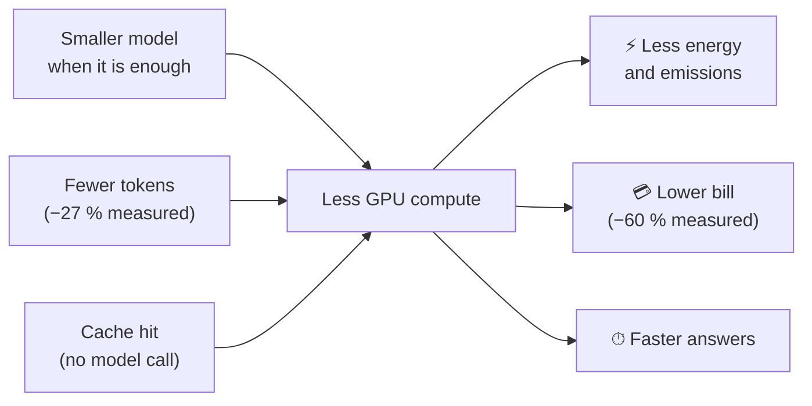

- **Compute and energy.** Smaller models do less computation per token, and fewer tokens means less computation overall. Research on AI inference shows energy use depends on model size and on how many tokens are generated ([Luccioni et al., *Power Hungry Processing*, ACM FAccT 2024](https://arxiv.org/abs/2311.16863)).
- **Tokens.** Measured: 27 % fewer tokens than sending everything to Opus, and tokens 40× cheaper whenever Haiku is enough.
- **Credits.** Measured: a 60 % lower bill on our benchmark. A question that was already answered costs nothing.
- **Time.** Small models answer faster, and a clarifying question avoids redoing a wrong answer.

**Ecological impact, stated honestly.** Less compute means less electricity and fewer emissions, but Anthropic does not publish energy figures per request, so we cannot convert our savings into watt-hours or grams of CO₂ without inventing numbers. We report what we can measure (tokens and cost) and treat it as the proxy for compute.

## How ThinkLess works

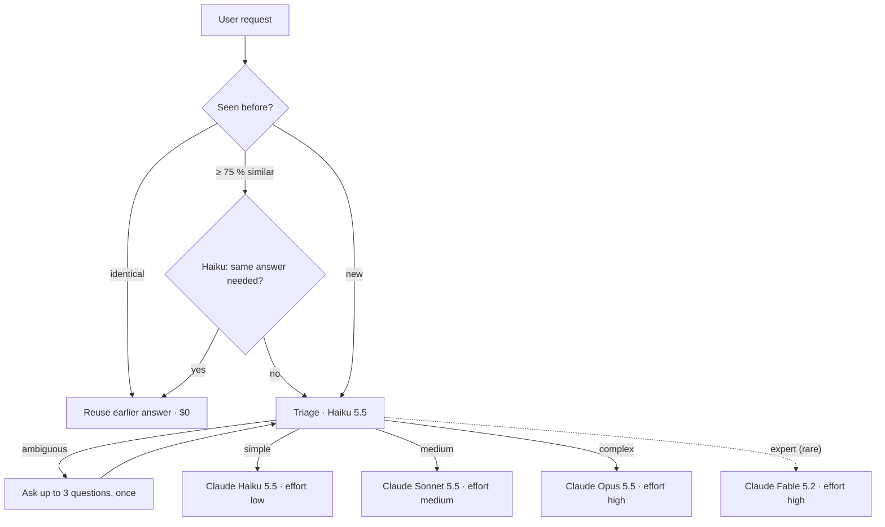

1. **Cache.** An identical question is free. A similar one (text similarity ≥ 75 %) is checked by Haiku before reuse: "capital of France" and "capital of Germany" look 87 % alike but need different answers.
2. **Triage.** Claude Haiku 5.5 reads the request and returns a structured verdict: is anything essential missing, how hard is it, and a short brief for the model that will answer.
3. **Clarify.** If a missing detail would change the answer, ThinkLess asks at most 3 short questions, once. A question costs a fraction of a cent; a wrong expensive answer costs the whole call.
4. **Route.** The smallest sufficient model answers, with the original request (which always wins) plus the triage brief. Claude Fable 5.2, twice the price of Opus, is reserved for frontier-level work such as research-level proofs; textbook proofs and usual system design stay on Opus.
5. **Measure.** Every step records real token counts from the API and its cost.

The triage is an LLM, not keyword rules, because it understands meaning. Hard limits (max 3 questions, one round only, unknown tiers fall back to medium) are enforced in Python, because a prompt is a request, not a guarantee.

## Ways to use it

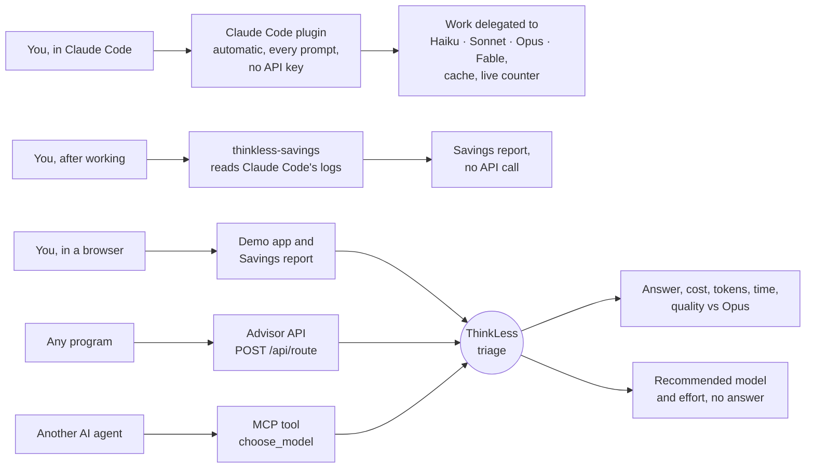

| Mode | What it does | Entry point | API key |
|---|---|---|---|
| **Claude Code plugin** | Routes **every** prompt automatically: a Haiku lead delegates the work to a Claude Sonnet 5.5, Opus 5.5 or Fable 5.2 subagent when the task deserves it, reuses earlier answers, and shows a live savings counter. Nothing to type | `claude plugin install thinkless@thinkless` | Optional |
| **Savings dashboard** | Reads Claude Code's own session logs and shows, prompt by prompt, the actual cost and the same work priced as Opus 5.5 | `thinkless-savings` | No |
| **Savings report** | Paste a prompt: ThinkLess and Opus 5.5 both answer it, a judge grades both blind, and the page shows money, tokens and time saved, quality kept, and both answers side by side | Demo app, "Savings report" tab | Yes (a few cents per report) |
| **Demo app** | Answers the request and shows every decision, its model, tokens, cost and time, next to "everything on Opus" | `uv run thinkless` → http://127.0.0.1:8000 | Yes |
| **Advisor API** | Returns the recommended model and effort, without answering; accepts your own list of models | `POST /api/route` | Yes |
| **MCP tool** | Plugs into Claude Code or any MCP agent as a `choose_model` tool, for any model family | `uv run thinkless-mcp` | Yes |

## ThinkLess acts: automatic routing in Claude Code

With the plugin, ThinkLess is no longer an advisor you have to call. The session's lead agent, **ThinkLess Router** (on Claude Haiku 5.5), decides which Claude model each request needs and **delegates** the work to it; a hook runs before every prompt to offer cached answers and the live savings counter. Only hard tasks climb to Sonnet, Opus or Fable.

It works in two modes:

| | Without an API key (default) | With an API key (precise) |
|---|---|---|
| Who decides the model | The router itself, from the rules in its system prompt, inside your Claude plan | A dedicated triage call (Claude Haiku with a fixed JSON answer and hard limits in code), named in a `[ThinkLess advice]` note the router follows |
| Extra cost | None beyond your plan's usage | About 0.02 ¢ per message, billed to the key |
| Cache, counter, savings dashboard | Yes | Yes |

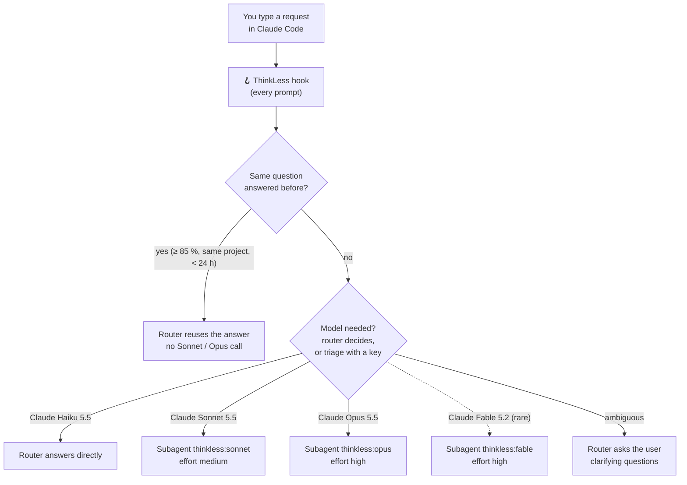

Every answer opens with the model that did the work and the live counter:

```text
(ThinkLess: Claude Sonnet 5.5 · saved so far: $1.43 vs Opus 5.5 (−40 %) over 25 prompts)
```

With a key, Claude also sees the triage note before it answers, for example:

```text
[ThinkLess advice · triage by Claude Haiku · cost 0.022 ¢]
Model: Claude Opus 5.5 · effort high (difficulty: complex).
Reason: System design with real trade-offs at a meaningful scale requires a strong model.
Required action: use Claude Opus 5.5. Your first step must be an Agent tool call with subagent_type "thinkless:opus" ...
```

**Measured in real Claude Code runs** (lead agent ThinkLess Router on Haiku, Nov 2026; one run each, costs from Claude Code's own usage report):

| Prompt | Mode | What happened | Cost |
|---|---|---|---|
| "What is the capital of Australia?" | key | Haiku answered | $0.003 |
| "Write a Python function that reads a CSV of expenses…" | key | delegated to Sonnet 5.5 | Haiku $0.004 + Sonnet $0.079 |
| "Design the architecture of a ride-sharing app for 50,000 students…" | key | delegated to Opus 5.5 | Haiku $0.005 + Opus $0.204 |
| Same CSV request | no key | the router chose Sonnet 5.5 itself | Haiku $0.003 + Sonnet $0.071 |
| "Write a Python function that sums a list of invoice amounts…" | no key | delegated to Sonnet 5.5 | 2.46 ¢ |
| The same invoice request, in a new session | no key | **answer reused from the cache**, no Sonnet call | **0.25 ¢** |

The Fable tier was checked on routing only: a research-level request ("a new approach to bound the gaps between consecutive primes, with proof sketches") was sent to Claude Fable 5.2, while "prove that √2 is irrational" stayed on Opus 5.5. For comparison, Claude Code running on Opus spent $0.11 to $0.13 on a five-bullet summary that ThinkLess sends to Haiku or Sonnet. These are single runs, not a benchmark: the [API benchmark](#results) is the controlled measurement.

**Why a dedicated lead agent.** When the advice only arrives as a note next to the prompt, the lead sometimes ignores it: in an interactive test, a plain Haiku session received "delegate to the Sonnet subagent" and wrote the code itself. Running the session as the `thinkless:router` agent puts the routing rules in the lead's **system prompt**, where they carry more weight. With the router, every routing test we ran was followed, with or without a key.

### Answer cache

A `Stop` hook stores each finished exchange (the question and the router's final answer) in `~/.config/thinkless/cache.json`. Before the next prompt, the hook looks for a stored question that is at least **85 %** similar, in the **same project**, from the **last 24 hours** (free text similarity, no model call). On a match, it hands the earlier answer to the router, which reuses it only if the new request asks exactly the same thing and cannot depend on files or conversation that changed. The cache saves the most when it avoids a Sonnet or Opus call; on a question Haiku would answer anyway, it saves nothing.

### Live savings counter

Before each prompt the hook reads Claude Code's own session logs, totals what ThinkLess has saved so far, and the router copies it into its opening line. A small index (file size and modification time) means only the session that changed is re-read, in about half a second. The counter covers the prompts before the current one. Hide it with `THINKLESS_COUNTER=off`.

### Savings dashboard (`thinkless-savings`)

```bash
uvx --from git+https://github.com/JacobRoche123/codejam-2026 thinkless-savings
```

It reads `~/.claude/projects` (no API call), keeps the prompts ThinkLess actually routed (the router lead or a ThinkLess worker subagent; a session that received advice but ignored it does not count), and opens an HTML page: totals, cost by model, and every prompt with the models used, the actual cost and the Opus 5.5 estimate.

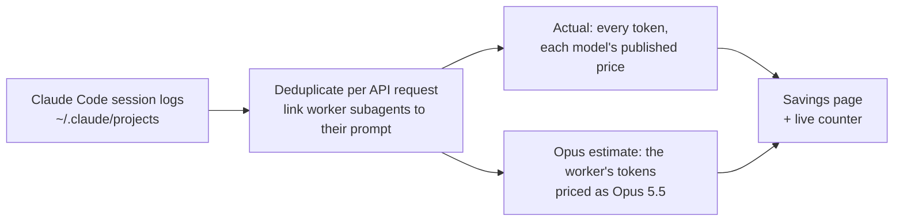

How the numbers are built:

- **Actual cost:** every token each model used in the turn (router and worker subagents), at Anthropic's published API prices, including 1-hour cache writes (2× input) and per-model cache-read prices, plus the triage when a key is set.
- **Opus estimate:** the tokens of the model that did the work (the worker subagent, or the router when it answered itself), priced as Claude Opus 5.5. A real Opus run would use a somewhat different number of tokens, so this is an estimate.
- **Subscription:** on a Claude plan you are not billed per token; these are API-equivalent amounts, and savings mean less of your plan's usage.
- On this Mac, after the tests above: 26 routed prompts, **−42 %** against the Opus estimate. On a task that really needs Opus, ThinkLess costs slightly more (+3 % in our runs: the Haiku lead's overhead); the dashboard shows that too.

### Install (Claude Code)

1. Add the marketplace and install the plugin:

   ```bash
   claude plugin marketplace add JacobRoche123/codejam-2026
   claude plugin install thinkless@thinkless
   ```

2. Start Claude Code with the ThinkLess Router as the lead agent, and work as usual:

   ```bash
   claude --agent thinkless:router
   ```

3. Optional, for the precise triage: save an Anthropic API key in ThinkLess's own private file (hidden while you paste it):

   ```bash
   mkdir -p ~/.config/thinkless && read -s "K?Paste your Anthropic API key: " && printf '%s' "$K" > ~/.config/thinkless/api_key && chmod 600 ~/.config/thinkless/api_key && unset K && echo
   ```

   Do **not** export `ANTHROPIC_API_KEY` in your shell for this: Claude Code itself would pick it up and switch from your subscription to API billing.

Turn the hook off for one session with `THINKLESS_HOOK=off claude`. Slash commands and replies under three words are never triaged. The hook runs in every Claude Code session once the plugin is enabled; to keep it only for the sessions you choose, disable the plugin (`claude plugin disable thinkless@thinkless`) and load it per session with `--plugin-dir`. A step-by-step guide for beginners is in [THINKLESS.md](THINKLESS.md).

**Limits.** Delegation depends on the lead model following its instructions: reliable with the router in our runs, not with a plain session. Without a key, the router's own triage has no enforced answer format and no hard limits in code. The hook only sees the current message, not the conversation, so a short follow-up such as "step 6 problem" can be misjudged. Each subagent call carries Claude Code's own context, so a medium task costs more than in the raw API benchmark. The hook adds about half a second (counter and cache) and, with a key, 2 to 3 seconds of triage. Fable 5.2 costs twice as much as Opus 5.5, which is why its rule is strict. The cache can only be as fresh as its 24-hour window and the router's judgment.

## Savings report: what did ThinkLess save on my prompt?

The demo app has a **Savings report** tab. Unlike the dashboard above, it re-runs the prompt and measures quality, so it calls the API (a few cents per report, on the key in `.env.local`). Paste any prompt you sent to Claude:

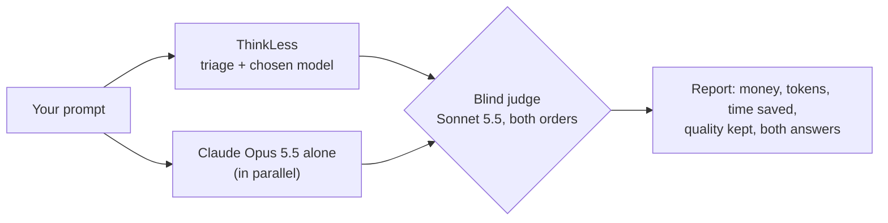

Two real reports (one run each, Nov 2026):

| Prompt | Model chosen | Cost vs Opus alone | Tokens | Quality (judge) | Time |
|---|---|---|---|---|---|
| Python function for a CSV of expenses | Claude Sonnet 5.5 | 0.68 ¢ vs 3.08 ¢ (**−78 %**) | −33 % | 8/10 vs 8/10 | 6.4 s vs 13.3 s |
| Translate a sentence into Spanish and Italian | Claude Haiku 5.5 | 0.01 ¢ vs 0.38 ¢ (**−97 %**) | +54 % | 10/10 vs 10/10 | 2.6 s vs 1.9 s |

On tiny prompts the triage adds tokens and about a second, but they are Haiku tokens, 40× cheaper than Opus output tokens. The judge's cost (about 0.4 ¢) is shown separately: it measures the saving and is not part of it.

## Install ThinkLess as an advisor tool (one command)

Anyone can add ThinkLess to their AI agent. It shows up as **"ThinkLess advisor"**, a read-only tool: it recommends a model and an effort level, and never answers or changes anything. No need to download the project.

> **New to the Terminal?** Follow the beginner guide: **[docs/INSTALL.md](docs/INSTALL.md)**. It says which app to open, what to type and what you should see at every step.

You need [uv](https://docs.astral.sh/uv/) (`brew install uv`, or see step 1 below) and your own [Anthropic API key](https://console.anthropic.com/): each piece of advice is one Claude Haiku call, about 0.02 cents, billed to your key.

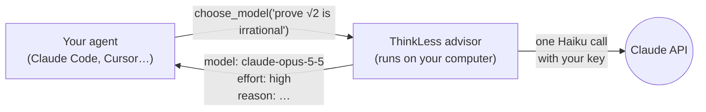

**Claude Code** (tested):

```bash
claude mcp add thinkless --scope user -e ANTHROPIC_API_KEY=sk-ant-your-key -- uvx --from git+https://github.com/JacobRoche123/codejam-2026 thinkless-mcp
```

Check with `claude mcp list`, then ask Claude: *"Use the thinkless choose_model tool for: prove that √2 is irrational."*

**Claude Desktop, Cursor, Gemini CLI and other MCP clients** (same protocol, not tested): add this block to the client's MCP settings file (`claude_desktop_config.json`, `~/.cursor/mcp.json` or `~/.gemini/settings.json`), then restart the app:

```json
{
  "mcpServers": {
    "thinkless": {
      "command": "uvx",
      "args": ["--from", "git+https://github.com/JacobRoche123/codejam-2026", "thinkless-mcp"],
      "env": { "ANTHROPIC_API_KEY": "sk-ant-your-key" }
    }
  }
}
```

If a desktop app cannot find `uvx`, replace `"uvx"` with its full path (run `which uvx` in a terminal). If the key is missing or wrong, the tool tells the agent how to fix it.

---

## Results

All numbers below are **measured** from real API calls: token counts come from the Claude API, prices are Anthropic's published rates. Raw data is in [`bench/`](bench/). The benchmark was run before the Fable 5.2 tier existed (three tiers: Haiku, Sonnet, Opus), and its costs used a flat 10 % cache-read rate, since replaced by published cache prices; cache reads are a small share of these runs.

### Router vs. "everything on Opus 5.5" (20 tasks)

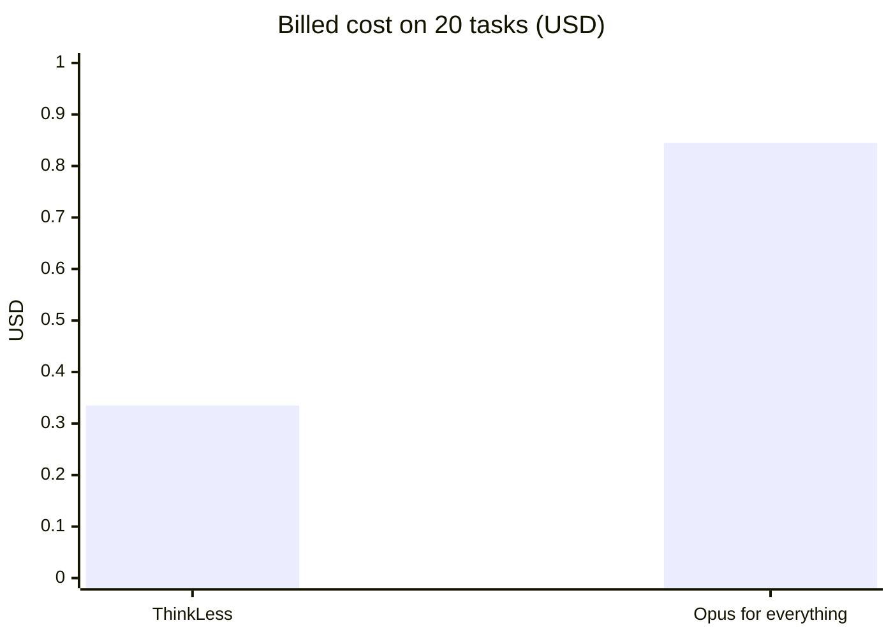

| | ThinkLess | Opus 5.5 for everything |
|---|---|---|
| Billed cost | **$0.335** | $0.845 |
| Tokens | **31,988** | 43,618 |
| Quality (judged /10) | **8.0** | 8.8 |

**60 % less billed compute, keeping 91 % of Opus's quality.**

How quality is judged: Claude Sonnet 5.5 grades both answers blind, **twice, with the order swapped**, and we average the scores to cancel position bias and noise. The 20 tasks mix simple facts, code, explanations, proofs, system design and 2 ambiguous requests ([`bench/tasks.json`](bench/tasks.json)).

We iterated three times, fixing what the benchmark revealed:

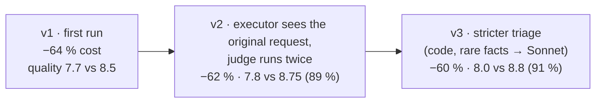

### Thinking effort vs. model choice

Same model (Sonnet 5.5), same 6 tasks, three effort levels. Thinking tokens are billed as output, so fewer tokens means less compute.

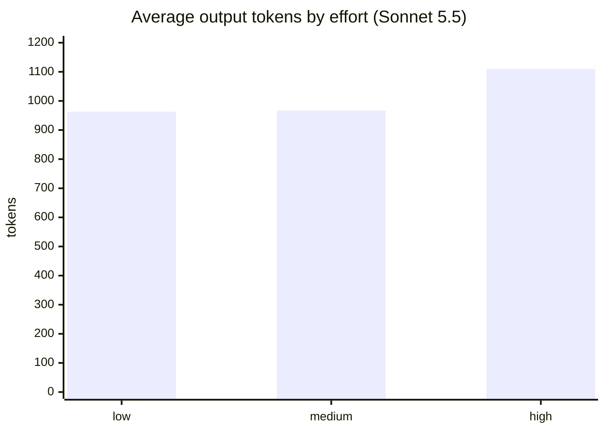

| Effort | Avg output tokens | vs. high | Quality vs. high |
|---|---|---|---|
| low | 963 | 87 % | 7.5 vs 8.4 |
| medium | 967 | 87 % | 8.1 vs 8.6 |
| high | 1,110 | 100 % | reference |

**Lowering effort saves about 13 % of tokens. Switching from Opus to Haiku cuts the price per token by 40×.** Choosing the right model is the main lever, which is why ThinkLess routes between models first.

### What we did not measure

- **Energy.** Anthropic does not publish per-request energy use, so we show no watt-hours. We use billed tokens and cost as the measurable proxy for compute: a bigger model costs more per token because it uses more compute per token.
- **A held-out test set.** The triage rules were tuned on the same 20 tasks they are scored on, so the numbers may be slightly optimistic. A fresh task set is the next thing to add.

---

## Limits

- **Advice, not control.** In the MCP and advisor modes, ThinkLess recommends a model; an agent cannot switch its own model mid-conversation. The advice pays off where the agent can delegate work, for example to a subagent.
- **Rare facts need big models.** Neither Haiku nor Sonnet knew what McGill's ECSESS is; only Opus did. Triage cannot always tell when a "simple" fact is actually obscure.
- **Prudence costs.** When unsure, triage picks the higher tier (never Fable by default). That protects quality but sometimes overspends, for example sending a classic proof to Opus.
- **Fable 5.2 is routed, not benchmarked.** We checked which requests reach it, not the quality or savings of its answers.
- **The triage can ignore its own rules.** It is instructed that answers with more than one line of code are "medium", and it sometimes still says "simple".
- **The similarity cache lives in memory** and misses paraphrases that share few words ("Where does Australia's government sit?").

---

## Step-by-step setup

ThinkLess is not a model: it is a small program that chooses between Claude models. You run it on your computer. Tested on macOS; Linux should work the same way.

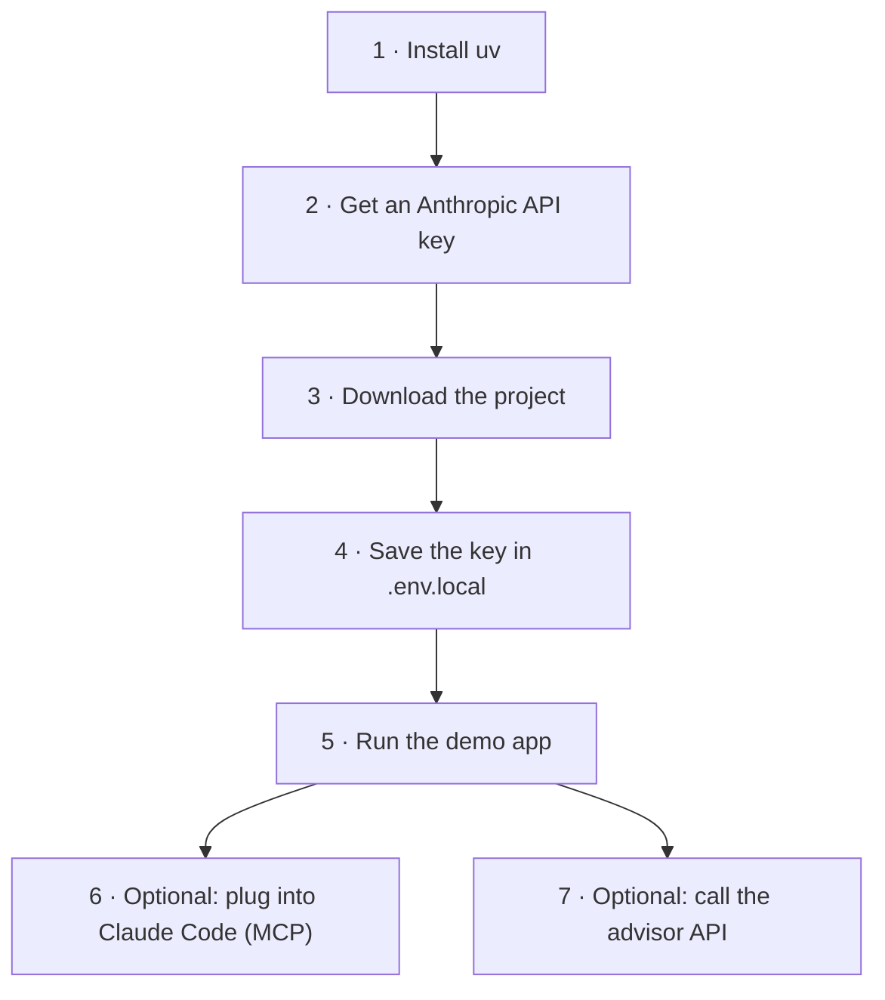

**1. Install uv** (it installs the right Python version and the libraries for you):

```bash
curl -LsSf https://astral.sh/uv/install.sh | sh
```

On a Mac with Homebrew, `brew install uv` works too. Open a new terminal afterwards.

**2. Get an Anthropic API key.** Create one at [console.anthropic.com](https://console.anthropic.com/) (Settings → API Keys). The API is billed by usage, separately from a Claude Pro subscription; trying the demo costs a few cents.

**3. Download the project:**

```bash
git clone https://github.com/JacobRoche123/codejam-2026.git
cd codejam-2026
```

**4. Save your key** in a file named `.env.local`. This command asks for the key without showing it on screen; the file is listed in `.gitignore`, so it is never published:

```bash
read -s "K?Paste your Anthropic API key: " && printf 'ANTHROPIC_API_KEY=%s\n' "$K" > .env.local && chmod 600 .env.local && unset K
```

(That is zsh, the default shell on macOS. In bash, use `read -s -p "Paste your key: " K` for the first part.)

**5. Start the demo app** and open http://127.0.0.1:8000:

```bash
uv run thinkless
```

Click the "Simple" example, tick "Compare with everything on Opus" and press "Send". The right column shows each decision, its model, tokens and cost. Stop the server with `Ctrl+C`.

**6. (Optional) Plug your local copy into Claude Code** as an MCP tool (to use the published version instead, see [Install ThinkLess as an advisor tool](#install-thinkless-as-an-advisor-tool-one-command)). Replace the path with where you cloned the project:

```bash
claude mcp add thinkless --scope user -- uv --directory /path/to/codejam-2026 run thinkless-mcp
```

Check it with `claude mcp list` (you should see `thinkless ... ✔ Connected`). Then start `claude` and ask, for example: *"Use the thinkless choose_model tool for: prove that √2 is irrational."* The demo server does not need to be running for this; Claude Code starts ThinkLess itself.

**7. (Optional) Ask the advisor over HTTP**, like any program could (needs the server from step 5):

```bash
curl -s -X POST http://127.0.0.1:8000/api/route \
  -H "Content-Type: application/json" \
  -d '{"request": "Translate hello into Spanish"}'
```

## Which agents can use it?

ThinkLess speaks the [Model Context Protocol](https://modelcontextprotocol.io/) (MCP), the open standard many AI agents use to plug in tools. It currently runs as a **local** MCP server: the agent starts it on your computer and talks to it over stdio.

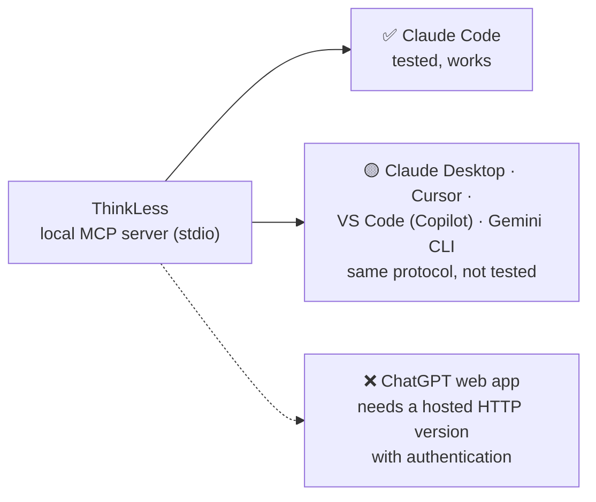

### Works with any model family

ThinkLess judges **how hard a task is**, which does not depend on the provider. An agent can send **its own models**, ordered from smallest/cheapest to largest, and the advice then names one of them:

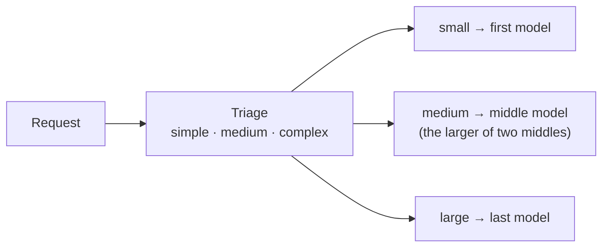

```bash
curl -s -X POST http://127.0.0.1:8000/api/route \
  -H "Content-Type: application/json" \
  -d '{"request": "Prove that √2 is irrational", "available_models": ["small-model", "medium-model", "large-model"]}'
```

```json
{"tier": "complex", "size": "large", "model": "large-model", "effort": "high", "source": "your list"}
```

The MCP tool takes the same optional `available_models` argument, and its description tells agents to pass their models. Without a list, ThinkLess recommends Claude models (Haiku, Sonnet, Opus). The `effort` field (low, medium, high) is a hint: use your provider's closest setting, if it has one.

**Still required:** the triage itself runs on Claude Haiku, so an Anthropic API key is needed whatever the agent. Next steps to remove that: other triage backends, or MCP *sampling* (letting the agent's own model do the triage), which few clients support today.

## Tests and benchmarks

Run the tests (offline, free, with a fake model):

```bash
uv run pytest -q          # 87 tests
```

Reproduce the benchmarks (real API calls, about $1.60 and $0.80):

```bash
uv run python bench/run.py
cd bench && uv run python effort.py
```

## Architecture

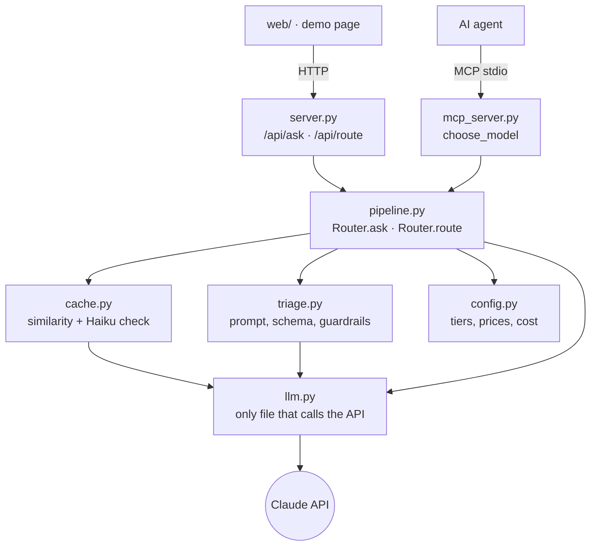

| File | Role |
|---|---|
| [`src/thinkless/config.py`](src/thinkless/config.py) | Model tiers, published prices, thresholds, cost formula |
| [`src/thinkless/llm.py`](src/thinkless/llm.py) | The only file that calls the Claude API (swappable for a fake in tests) |
| [`src/thinkless/triage.py`](src/thinkless/triage.py) | Triage prompt, structured-output schema, Python guardrails |
| [`src/thinkless/cache.py`](src/thinkless/cache.py) | Text similarity + Haiku confirmation |
| [`src/thinkless/pipeline.py`](src/thinkless/pipeline.py) | `Router.ask` (full answer) and `Router.route` (advice only), with per-step tracing |
| [`src/thinkless/server.py`](src/thinkless/server.py) | FastAPI: `/api/ask`, `/api/route`, `/api/benchmark` |
| [`src/thinkless/mcp_server.py`](src/thinkless/mcp_server.py) | MCP server exposing `choose_model` |
| [`src/thinkless/report.py`](src/thinkless/report.py) | Savings report: ThinkLess vs Opus 5.5 on one prompt |
| [`src/thinkless/judge.py`](src/thinkless/judge.py) | Blind judge (both orders), shared by the report and the benchmark |
| [`src/thinkless/memory.py`](src/thinkless/memory.py) | Answer cache of the plugin: reads transcripts, stores and finds similar questions |
| [`src/thinkless/savings.py`](src/thinkless/savings.py) | Savings dashboard and live counter, from Claude Code's logs |
| [`src/thinkless/hook.py`](src/thinkless/hook.py) | Claude Code hook: triages every prompt and tells Claude which subagent to use |
| [`plugin/`](plugin/) | Claude Code plugin: the hook, the MCP server, the `router` lead agent and the `haiku`, `sonnet`, `opus`, `fable` subagents |
| [`web/`](web/) | Demo page: live trace, benchmark tab, how-it-works |
| [`bench/`](bench/) | Tasks, benchmark scripts and raw results |
| [`tests/`](tests/) | 87 offline tests |

**Stack:** Python 3.12, Anthropic Python SDK, FastAPI, MCP Python SDK, vanilla HTML/CSS/JS. Models: Claude Haiku 5.5, Sonnet 5.5 and Opus 5.5.

---

Built by Jacob Roche at CodeJam 16, with Claude Code as a pair programmer.
