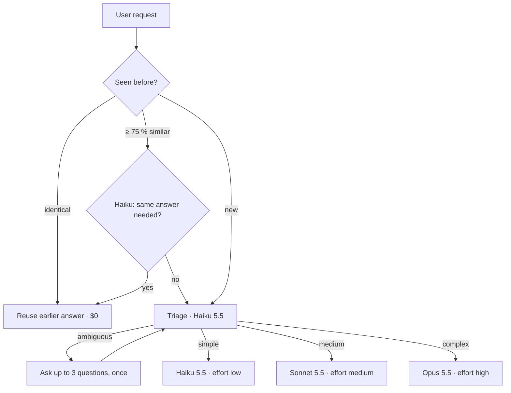

# ThinkLess

**Ask before thinking. Then use the smallest model that does the job.**

ThinkLess is a router that sits in front of an AI assistant. For every request it decides, for a fraction of a cent, whether the request is clear enough to answer and how much model it really needs, so simple questions stop being answered by the most expensive model.

Built in 24 hours at **CodeJam 16** (McGill University, November 2026) for the **Agent Solution** track: efficient use of compute, with a demo that shows *how* the agent decides, not just what it produces.

---

## The problem

Most AI apps send every request to their strongest model. "What is the capital of Australia?" and "Design a ride-sharing system for 50,000 users" get the same treatment and the same bill. On top of that, an assistant that misunderstands a vague request wastes a whole expensive answer.

## How ThinkLess works



1. **Cache.** An identical question is free. A similar one (text similarity ≥ 75 %) is checked by Haiku before reuse: "capital of France" and "capital of Germany" look 87 % alike but need different answers.
2. **Triage.** Claude Haiku 5.5 reads the request and returns a structured verdict: is anything essential missing, how hard is it, and a short brief for the model that will answer.
3. **Clarify.** If a missing detail would change the answer, ThinkLess asks at most 3 short questions, once. A question costs a fraction of a cent; a wrong expensive answer costs the whole call.
4. **Route.** The smallest sufficient model answers, with the original request (which always wins) plus the triage brief.
5. **Measure.** Every step records real token counts from the API and its cost.

The triage is an LLM, not keyword rules, because it understands meaning. Hard limits (max 3 questions, one round only, unknown tiers fall back to medium) are enforced in Python, because a prompt is a request, not a guarantee.

## Three ways to use it

| Mode | What it does | Entry point |
|---|---|---|
| **Demo app** | Answers the request and shows every decision, its model, tokens, cost and time, next to "everything on Opus" | `uv run thinkless` → http://127.0.0.1:8000 |
| **Advisor API** | Returns the recommended model and effort, without answering | `POST /api/route` |
| **MCP tool** | Plugs into Claude Code, Claude Desktop or any MCP agent as a `choose_model` tool | `uv run thinkless-mcp` |

---

## Results

All numbers below are **measured** from real API calls: token counts come from the Claude API, prices are Anthropic's published rates. Raw data is in [`bench/`](bench/).

### Router vs. "everything on Opus 5.5" (20 tasks)

| | ThinkLess | Opus 5.5 for everything |
|---|---|---|
| Billed cost | **$0.335** | $0.845 |
| Tokens | **31,988** | 43,618 |
| Quality (judged /10) | **8.0** | 8.8 |

**60 % less billed compute, keeping 91 % of Opus's quality.**

How quality is judged: Claude Sonnet 5.5 grades both answers blind, **twice, with the order swapped**, and we average the scores to cancel position bias and noise. The 20 tasks mix simple facts, code, explanations, proofs, system design and 2 ambiguous requests ([`bench/tasks.json`](bench/tasks.json)).

We iterated three times, fixing what the benchmark revealed:

| Version | Change | Savings | Quality vs Opus |
|---|---|---|---|
| v1 | first run, single judge pass | 64 % | 7.7 vs 8.5 |
| v2 | executor always sees the original request; judge runs twice | 62 % | 7.8 vs 8.75 (89 %) |
| v3 | stricter triage: code, niche facts and detail-critical tasks go to Sonnet | **60 %** | **8.0 vs 8.8 (91 %)** |

### Thinking effort vs. model choice

Same model (Sonnet 5.5), same 6 tasks, three effort levels. Thinking tokens are billed as output, so fewer tokens means less compute.

| Effort | Avg output tokens | vs. high | Quality vs. high |
|---|---|---|---|
| low | 963 | 87 % | 7.5 vs 8.4 |
| medium | 967 | 87 % | 8.1 vs 8.6 |
| high | 1,110 | 100 % | reference |

**Lowering effort saves about 13 % of tokens. Switching from Opus to Haiku cuts the price per token by 40×.** Choosing the right model is the main lever, which is why ThinkLess routes between models first.

### What we did not measure

- **Energy.** Anthropic does not publish per-request energy use, so we show no watt-hours. We use billed tokens and cost as the measurable proxy for compute: a bigger model costs more per token because it uses more compute per token.
- **A held-out test set.** The triage rules were tuned on the same 20 tasks they are scored on, so the numbers may be slightly optimistic. A fresh task set is the next thing to add.

---

## Limits

- **Advice, not control.** In the MCP and advisor modes, ThinkLess recommends a model; an agent cannot switch its own model mid-conversation. The advice pays off where the agent can delegate work, for example to a subagent.
- **Rare facts need big models.** Neither Haiku nor Sonnet knew what McGill's ECSESS is; only Opus did. Triage cannot always tell when a "simple" fact is actually obscure.
- **Prudence costs.** When unsure, triage picks the higher tier. That protects quality but sometimes overspends, for example sending a classic proof to Opus.
- **The triage can ignore its own rules.** It is instructed that answers with more than one line of code are "medium", and it sometimes still says "simple".
- **The similarity cache lives in memory** and misses paraphrases that share few words ("Where does Australia's government sit?").

---

## Run it

Requirements: macOS or Linux, [uv](https://docs.astral.sh/uv/), and an Anthropic API key.

```bash
git clone https://github.com/JacobRoche123/codejam-2026.git
cd codejam-2026
echo 'ANTHROPIC_API_KEY=sk-ant-...' > .env.local   # never committed (.gitignore)
uv run thinkless                                   # then open http://127.0.0.1:8000
```

Ask the advisor directly, like an agent would:

```bash
curl -s -X POST http://127.0.0.1:8000/api/route \
  -H "Content-Type: application/json" \
  -d '{"request": "Translate hello into Spanish"}'
```

Plug it into Claude Code as an MCP tool:

```bash
claude mcp add thinkless --scope user -- uv --directory /path/to/codejam-2026 run thinkless-mcp
```

Run the tests (offline, free, with a fake model):

```bash
uv run pytest -q          # 26 tests
```

Reproduce the benchmarks (real API calls, about $1.60 and $0.80):

```bash
uv run python bench/run.py
cd bench && uv run python effort.py
```

## Architecture

| File | Role |
|---|---|
| [`src/thinkless/config.py`](src/thinkless/config.py) | Model tiers, published prices, thresholds, cost formula |
| [`src/thinkless/llm.py`](src/thinkless/llm.py) | The only file that calls the Claude API (swappable for a fake in tests) |
| [`src/thinkless/triage.py`](src/thinkless/triage.py) | Triage prompt, structured-output schema, Python guardrails |
| [`src/thinkless/cache.py`](src/thinkless/cache.py) | Text similarity + Haiku confirmation |
| [`src/thinkless/pipeline.py`](src/thinkless/pipeline.py) | `Router.ask` (full answer) and `Router.route` (advice only), with per-step tracing |
| [`src/thinkless/server.py`](src/thinkless/server.py) | FastAPI: `/api/ask`, `/api/route`, `/api/benchmark` |
| [`src/thinkless/mcp_server.py`](src/thinkless/mcp_server.py) | MCP server exposing `choose_model` |
| [`web/`](web/) | Demo page: live trace, benchmark tab, how-it-works |
| [`bench/`](bench/) | Tasks, benchmark scripts and raw results |
| [`tests/`](tests/) | 26 offline tests |

**Stack:** Python 3.12, Anthropic Python SDK, FastAPI, MCP Python SDK, vanilla HTML/CSS/JS. Models: Claude Haiku 5.5, Sonnet 5.5 and Opus 5.5.

---

Built by Jacob Roche at CodeJam 16, with Claude Code as a pair programmer.
