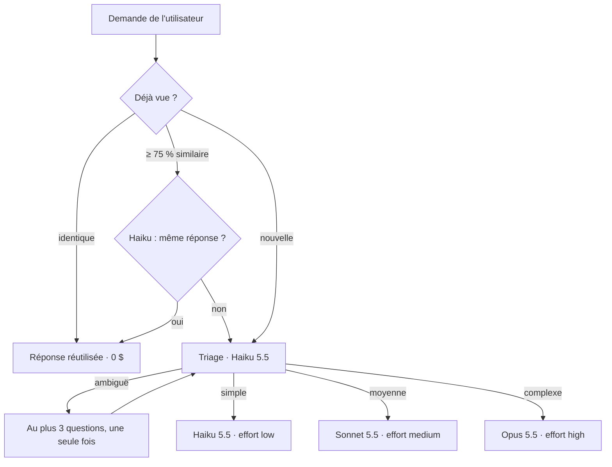

# ThinkLess

*Version française · [English version](README.en.md)*

**Avant de réfléchir, il demande. Puis il choisit le plus petit modèle qui suffit.**

ThinkLess est un aiguilleur placé devant un assistant IA. Pour chaque demande, il décide, pour une fraction de cent, si la demande est assez claire pour y répondre et quelle taille de modèle elle mérite vraiment. Les questions simples ne sont plus traitées par le modèle le plus cher.

Construit en 24 heures à **CodeJam 16** (Université McGill, novembre 2026) pour le défi **Agent Solution** : utiliser le calcul efficacement, avec une démo qui montre *comment* l'agent décide, et pas seulement ce qu'il produit.

---

## Le problème

La plupart des applications d'IA envoient toutes les demandes à leur modèle le plus puissant. « Quelle est la capitale de l'Australie ? » et « Conçois un système de covoiturage pour 50 000 utilisateurs » reçoivent le même traitement et la même facture. En plus, un assistant qui comprend mal une demande vague gaspille une réponse coûteuse tout entière.

## Pourquoi c'est important

Chaque jeton qu'un modèle génère passe par des milliards de paramètres sur un processeur graphique (GPU). Réduire ce travail permet d'économiser quatre choses à la fois :

| Ressource | Comment ThinkLess l'économise |
|---|---|
| **Calcul et énergie** | Un petit modèle fait moins de calculs par jeton, et moins de jetons, c'est moins de calcul au total. La recherche sur l'IA montre que l'énergie consommée dépend de la taille du modèle et du nombre de jetons générés ([Luccioni et al., *Power Hungry Processing*, ACM FAccT 2024](https://arxiv.org/abs/2311.16863)). |
| **Jetons** | Mesuré : 27 % de jetons en moins que « tout sur Opus », et des jetons 40 fois moins chers quand Haiku suffit. |
| **Crédits (argent)** | Mesuré : une facture 60 % plus basse sur notre banc d'essai. Une question déjà posée ne coûte rien. |
| **Temps** | Les petits modèles répondent plus vite, et une question de clarification évite de refaire une mauvaise réponse. |

**L'impact écologique, en toute honnêteté.** Moins de calcul, c'est moins d'électricité et moins d'émissions. Mais Anthropic ne publie pas la consommation d'énergie par requête : on ne peut donc pas convertir nos économies en watts-heures ou en grammes de CO₂ sans inventer des chiffres. On présente ce qu'on peut mesurer (les jetons et le coût) comme indicateur du calcul.

## Comment fonctionne ThinkLess



1. **Cache.** Une question identique est gratuite. Une question similaire (ressemblance du texte ≥ 75 %) est vérifiée par Haiku avant d'être réutilisée : « capitale de la France » et « capitale de l'Allemagne » se ressemblent à 87 %, mais n'ont pas la même réponse.
2. **Triage.** Claude Haiku 5.5 lit la demande et rend un verdict structuré : manque-t-il une information essentielle, quelle est la difficulté, et un court brief pour le modèle qui répondra.
3. **Clarification.** Si une information manquante changerait la réponse, ThinkLess pose au plus 3 questions courtes, une seule fois. Une question coûte une fraction de cent ; une mauvaise réponse coûteuse coûte l'appel entier.
4. **Aiguillage.** Le plus petit modèle suffisant répond, avec la demande originale (qui a toujours le dernier mot) et le brief du triage.
5. **Mesure.** Chaque étape enregistre les vrais nombres de jetons renvoyés par l'API, et son coût.

Le triage est fait par un modèle d'IA, pas par des règles à mots-clés, parce qu'il comprend le sens. Les limites strictes (au plus 3 questions, un seul tour, un niveau inconnu devient « moyenne ») sont appliquées en Python : une consigne donnée à une IA est une demande, pas une garantie.

## Trois façons de l'utiliser

| Mode | Ce qu'il fait | Point d'entrée |
|---|---|---|
| **Application de démo** | Répond à la demande et affiche chaque décision, son modèle, ses jetons, son coût et son temps, à côté de « tout sur Opus » | `uv run thinkless` → http://127.0.0.1:8000 |
| **API conseiller** | Renvoie le modèle et l'effort recommandés, sans répondre | `POST /api/route` |
| **Outil MCP** | Se branche dans Claude Code, Claude Desktop ou tout agent MCP, sous la forme d'un outil `choose_model` | `uv run thinkless-mcp` |

---

## Résultats

Tous les chiffres ci-dessous sont **mesurés** sur de vrais appels : les nombres de jetons viennent de l'API Claude, et les prix sont les tarifs publiés par Anthropic. Les données brutes sont dans [`bench/`](bench/).

### ThinkLess contre « tout sur Opus 5.5 » (20 tâches)

| | ThinkLess | Opus 5.5 pour tout |
|---|---|---|
| Coût facturé | **0,335 $** | 0,845 $ |
| Jetons | **31 988** | 43 618 |
| Qualité (notée sur 10) | **8,0** | 8,8 |

**60 % de calcul facturé en moins, en gardant 91 % de la qualité d'Opus.**

Comment la qualité est notée : Claude Sonnet 5.5 note les deux réponses à l'aveugle, **deux fois, en inversant leur ordre**, et on fait la moyenne pour annuler le biais de position et le hasard. Les 20 tâches mélangent faits simples, code, explications, preuves, conception de systèmes et 2 demandes ambiguës ([`bench/tasks.json`](bench/tasks.json)).

Nous avons itéré trois fois, en corrigeant ce que le banc d'essai révélait :

| Version | Changement | Économie | Qualité vs Opus |
|---|---|---|---|
| v1 | premier essai, un seul passage du juge | 64 % | 7,7 vs 8,5 |
| v2 | le modèle qui répond voit toujours la demande originale ; le juge note deux fois | 62 % | 7,8 vs 8,75 (89 %) |
| v3 | triage plus strict : le code, les faits rares et les tâches où un détail compte vont à Sonnet | **60 %** | **8,0 vs 8,8 (91 %)** |

### Effort de réflexion contre choix du modèle

Même modèle (Sonnet 5.5), mêmes 6 tâches, trois niveaux d'effort. Les jetons de réflexion sont facturés comme des jetons de sortie : moins de jetons, c'est moins de calcul.

| Effort | Jetons de sortie (moy.) | vs high | Qualité vs high |
|---|---|---|---|
| low | 963 | 87 % | 7,5 vs 8,4 |
| medium | 967 | 87 % | 8,1 vs 8,6 |
| high | 1 110 | 100 % | référence |

**Baisser l'effort n'économise qu'environ 13 % des jetons. Passer d'Opus à Haiku divise le prix par jeton par 40.** Le choix du modèle est le levier principal : c'est pourquoi ThinkLess choisit d'abord le bon modèle.

### Ce que nous n'avons pas mesuré

- **L'énergie.** Anthropic ne publie pas la consommation par requête, donc nous n'affichons pas de watts-heures. Nous utilisons les jetons et le coût facturés comme indicateur mesurable du calcul : un modèle plus gros coûte plus cher par jeton parce qu'il fait plus de calculs par jeton.
- **Des tâches jamais vues.** Les règles du triage ont été ajustées sur les mêmes 20 tâches que celles qui servent à les noter : les chiffres sont peut-être un peu optimistes. Un nouveau jeu de tâches est la prochaine chose à ajouter.

---

## Limites

- **Un conseil, pas un contrôle.** En mode conseiller et en mode MCP, ThinkLess recommande un modèle, mais un agent ne peut pas changer son propre modèle en pleine conversation. Le conseil est utile là où l'agent peut confier le travail à un autre modèle, par exemple à un sous-agent.
- **Les faits rares demandent un gros modèle.** Ni Haiku ni Sonnet ne savaient ce qu'est l'ECSESS de McGill ; seul Opus le savait. Le triage ne peut pas toujours deviner qu'un fait « simple » est en réalité peu connu.
- **La prudence a un coût.** En cas de doute, le triage choisit le niveau supérieur. Cela protège la qualité, mais dépense parfois trop, par exemple en envoyant une preuve classique à Opus.
- **Le triage peut ignorer ses propres règles.** Il a pour consigne de classer « moyenne » toute réponse de plus d'une ligne de code, et il dit parfois quand même « simple ».
- **Le cache par ressemblance vit en mémoire** (il s'efface au redémarrage) et rate les reformulations qui partagent peu de mots (« Où siège le gouvernement australien ? »).

---

## Installation pas à pas

ThinkLess n'est pas un modèle : c'est un petit programme qui choisit entre des modèles Claude. Il s'exécute sur ton ordinateur. Testé sur macOS ; Linux devrait fonctionner de la même façon.

**1. Installer uv** (il installe la bonne version de Python et les bibliothèques à ta place) :

```bash
curl -LsSf https://astral.sh/uv/install.sh | sh
```

Sur un Mac avec Homebrew, `brew install uv` fonctionne aussi. Ouvre ensuite un nouveau Terminal.

**2. Obtenir une clé API Anthropic.** Crée-la sur [console.anthropic.com](https://console.anthropic.com/) (Settings → API Keys). L'API est facturée à l'usage, séparément d'un abonnement Claude Pro ; essayer la démo coûte quelques cents.

**3. Télécharger le projet :**

```bash
git clone https://github.com/JacobRoche123/codejam-2026.git
cd codejam-2026
```

**4. Enregistrer ta clé** dans un fichier nommé `.env.local`. Cette commande demande la clé sans l'afficher à l'écran ; le fichier est listé dans `.gitignore`, il n'est donc jamais publié :

```bash
read -s "K?Colle ta clé API Anthropic : " && printf 'ANTHROPIC_API_KEY=%s\n' "$K" > .env.local && chmod 600 .env.local && unset K
```

(C'est la syntaxe de zsh, le shell par défaut de macOS. Avec bash, remplace le début par `read -s -p "Colle ta clé : " K`.)

**5. Lancer l'application de démo**, puis ouvrir http://127.0.0.1:8000 :

```bash
uv run thinkless
```

Clique sur l'exemple « Simple », coche « Comparer avec « tout sur Opus » » et appuie sur « Envoyer ». La colonne de droite affiche chaque décision, son modèle, ses jetons et son coût. Pour arrêter le serveur : `Ctrl+C`.

**6. (Facultatif) Brancher ThinkLess dans Claude Code** comme outil MCP. Remplace le chemin par l'endroit où tu as téléchargé le projet :

```bash
claude mcp add thinkless --scope user -- uv --directory /chemin/vers/codejam-2026 run thinkless-mcp
```

Vérifie avec `claude mcp list` (tu dois voir `thinkless ... ✔ Connected`). Lance ensuite `claude` et demande par exemple : *« Utilise l'outil choose_model de thinkless pour : démontre que racine de 2 est irrationnel. »* Le serveur de démo n'a pas besoin de tourner : Claude Code démarre ThinkLess lui-même.

**7. (Facultatif) Interroger le conseiller en HTTP**, comme n'importe quel programme pourrait le faire (le serveur de l'étape 5 doit tourner) :

```bash
curl -s -X POST http://127.0.0.1:8000/api/route \
  -H "Content-Type: application/json" \
  -d '{"request": "Traduis bonjour en espagnol"}'
```

## Quels agents peuvent l'utiliser ?

ThinkLess parle le [Model Context Protocol](https://modelcontextprotocol.io/) (MCP), le standard ouvert que de nombreux agents IA utilisent pour brancher des outils. Pour l'instant, il fonctionne comme un serveur MCP **local** : l'agent le démarre sur ton ordinateur et lui parle par stdio.

| Agent | Serveurs MCP locaux | ThinkLess aujourd'hui |
|---|---|---|
| Claude Code | oui | **Testé, fonctionne** |
| Claude Desktop, Cursor, VS Code (mode agent de Copilot), Gemini CLI | oui | Devrait fonctionner avec la même commande ; **non testé** |
| ChatGPT (application web) | surtout des serveurs distants | **Pas encore** : il faudrait héberger ThinkLess en ligne, en HTTP, avec une authentification |

Deux réserves pour les agents qui ne sont pas Claude :

- Le conseil nomme des modèles **Claude**. Dans un autre écosystème, il faudrait faire correspondre les trois niveaux (simple, moyenne, complexe) aux petit, moyen et grand modèles de ce fournisseur.
- Le triage appelle toujours Claude Haiku : une clé API Anthropic est nécessaire, quel que soit l'agent.

## Tests et bancs d'essai

Lancer les tests (hors ligne, gratuits, avec un faux modèle) :

```bash
uv run pytest -q          # 26 tests
```

Reproduire les bancs d'essai (vrais appels à l'API, environ 1,60 $ et 0,80 $) :

```bash
uv run python bench/run.py
cd bench && uv run python effort.py
```

## Architecture

| Fichier | Rôle |
|---|---|
| [`src/thinkless/config.py`](src/thinkless/config.py) | Niveaux de modèles, prix publiés, seuils, formule de coût |
| [`src/thinkless/llm.py`](src/thinkless/llm.py) | Le seul fichier qui appelle l'API Claude (remplaçable par un faux dans les tests) |
| [`src/thinkless/triage.py`](src/thinkless/triage.py) | Consignes du triage, schéma de réponse structurée, garde-fous en Python |
| [`src/thinkless/cache.py`](src/thinkless/cache.py) | Ressemblance des textes + confirmation par Haiku |
| [`src/thinkless/pipeline.py`](src/thinkless/pipeline.py) | `Router.ask` (réponse complète) et `Router.route` (conseil seulement), avec la trace de chaque étape |
| [`src/thinkless/server.py`](src/thinkless/server.py) | FastAPI : `/api/ask`, `/api/route`, `/api/benchmark` |
| [`src/thinkless/mcp_server.py`](src/thinkless/mcp_server.py) | Serveur MCP qui expose `choose_model` |
| [`web/`](web/) | Page de démo : trace en direct, onglet banc d'essai, fonctionnement |
| [`bench/`](bench/) | Tâches, scripts de banc d'essai et résultats bruts |
| [`tests/`](tests/) | 26 tests hors ligne |

**Technologies :** Python 3.12, SDK Python d'Anthropic, FastAPI, SDK Python MCP, HTML/CSS/JS sans framework. Modèles : Claude Haiku 5.5, Sonnet 5.5 et Opus 5.5.

---

Construit par Jacob Roche à CodeJam 16, avec Claude Code comme partenaire de programmation.
