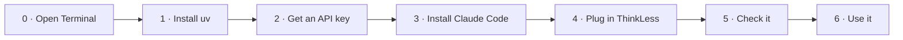

# Install ThinkLess on a Mac: step by step

This guide adds ThinkLess to **Claude Code** as an advisor tool. You do not need to download the project. For every step it says **which app to open**, **where to type**, **what to type**, and **what you should see**.

> **Most people want the plugin instead.** It routes every prompt automatically, needs no API key, reuses earlier answers and shows a live savings counter. Follow **[THINKLESS.md](../THINKLESS.md)**. This page is for the advisor tool alone (`choose_model`), which other agents can call and which does need an API key.



---

## Step 0: open the Terminal app

Terminal is an app on your Mac where you type commands instead of clicking.

1. Press **⌘ Command + Space**: a search bar (Spotlight) appears.
2. Type **`Terminal`** and press **Return** (↩).
3. A window opens with a line like this:

   ```text
   yourname@your-Mac ~ %
   ```

   The `%` at the end means **Terminal is waiting for a command**.

**How to run a command (for every step below):**

1. Copy the command from this page (copy button, or select it and press **⌘ C**).
2. Click **inside the Terminal window**.
3. Paste with **⌘ V**.
4. Press **Return** to run it.
5. Wait until the line ending with **`%`** comes back: the command is finished.

---

## Step 1: install uv

**What is it?** `uv` is a small program that downloads and runs Python programs such as ThinkLess. You install it once.

**Where:** in **Terminal**.

**Type:**

```bash
curl -LsSf https://astral.sh/uv/install.sh | sh
```

**You should see:** a few lines scroll by, then a message containing **`everything's installed!`**.

**Then (required):** quit Terminal completely with **⌘ Q** and open it again (step 0). Terminal only sees `uv` after a restart.

**Check:** in the new Terminal window, type:

```bash
uvx --version
```

You should see a line such as `uv 0.13.9` (the number may differ).

> If you see `command not found: uvx`, quit and reopen Terminal again. If it still fails, redo step 1.

---

## Step 2: get an Anthropic API key

**What is it?** An API key is a **secret password** that lets ThinkLess call Claude Haiku on your behalf. Each piece of advice costs about 0.02 cents, taken from your credit.

**Where:** in your **web browser** (Safari or Chrome).

1. Go to **https://console.anthropic.com**.
2. Sign in or create an account. This account is **separate** from a Claude Pro subscription.
3. **Add credit:** open **Billing** (or "Plans & Billing") and add the minimum amount, usually $5. Without credit, the key will not work.
4. Open **Settings → API Keys** and click **Create Key**.
5. Give it a name, for example `thinkless`, and confirm.
6. **Copy the key** (⌘ C). It starts with `sk-ant-`.

> ⚠️ **The key is shown only once.** Keep the page open until step 4. Never paste it into a chat, an email or GitHub.
>
> Menu names may differ slightly depending on the version of the site.

---

## Step 3: install Claude Code

**What is it?** Claude Code is the **agent** ThinkLess plugs into.

> Already installed? Skip to step 4.

**Where:** in **Terminal**.

**Type:**

```bash
curl -fsSL https://claude.ai/install.sh | bash
```

Then quit Terminal (**⌘ Q**), reopen it, and type:

```bash
claude
```

**You should see:** the Claude Code welcome screen. Pick a theme with the arrow keys, press Return, and sign in with your Claude account (a browser window opens). Once signed in, type **`/exit`** and press Return to get back to the Terminal line ending with `%`.

---

## Step 4: plug ThinkLess into Claude Code

**Where:** in **Terminal**, on the line ending with `%`. **Not** inside Claude Code.

> **Installed ThinkLess before?** Remove the old version first:
>
> ```bash
> claude mcp remove thinkless --scope user
> ```
>
> You should see a message like `Removed MCP server "thinkless"`.

**4a. Enter your key without showing it.** Type:

```bash
read -s "K?Paste your Anthropic API key: " && echo
```

Terminal shows `Paste your Anthropic API key:`. Paste your key with **⌘ V** and press **Return**.

> **Nothing appears when you paste: that is normal**, it hides the key on purpose. Just press Return.

**4b. Install ThinkLess.** Then type, **in the same Terminal window**:

```bash
claude mcp add thinkless --scope user -e ANTHROPIC_API_KEY="$K" -- uvx --from git+https://github.com/JacobRoche123/codejam-2026 thinkless-mcp && unset K
```

**You should see:** a message like `Added stdio MCP server thinkless`.

> If you close Terminal between 4a and 4b, the key is forgotten: start again at 4a.

**What each part does:**

- `--scope user`: ThinkLess is available in all your projects.
- `-e ANTHROPIC_API_KEY="$K"`: gives your key to ThinkLess, and to it only.
- `uvx --from git+https://github.com/...`: downloads ThinkLess from GitHub and starts it.
- `unset K`: erases the key from Terminal's memory.

---

## Step 5: check that ThinkLess is plugged in

**Where:** in **Terminal**.

**Type:**

```bash
claude mcp list
```

**You should see** a line ending with **`✔ Connected`**:

```text
thinkless: uvx --from git+https://github.com/JacobRoche123/codejam-2026 thinkless-mcp - ✔ Connected
```

The first time it can take **10 to 20 seconds**, while uv downloads ThinkLess.

---

## Step 6: use ThinkLess

**Where:** in **Claude Code**.

1. In Terminal, type `claude` and press Return. Claude Code opens.
2. In the input box at the bottom, type **`/mcp`** and press Return. You should see **thinkless** in the list. Press **Esc** to close it.
3. In the same input box, type:

   ```text
   Use the thinkless choose_model tool for: prove that √2 is irrational
   ```

4. If Claude asks for permission to use the tool, choose **Yes**.

**You should see:** a line **`Called thinkless`**, then the advice:

```text
"model": "claude-opus-5-5", "effort": "high", "reason": "..."
```

🎉 ThinkLess is installed and working.

---

## Troubleshooting

| What you see | Where | What it means | What to do |
|---|---|---|---|
| `command not found: uvx` | Terminal | uv is not installed, or Terminal does not see it yet | Quit and reopen Terminal (⌘ Q); otherwise redo step 1 |
| `command not found: claude` | Terminal | Claude Code is not found | Quit and reopen Terminal; otherwise redo step 3 |
| `zsh: command not found: Use` | Terminal | You typed a sentence in Terminal instead of Claude Code | Type `claude` first, then your sentence |
| `already exists` | Terminal, step 4b | ThinkLess is already installed | `claude mcp remove thinkless --scope user`, then redo 4a and 4b |
| `✗ Failed to connect` | Terminal, step 5 | No internet, or uvx not found | Check your Wi-Fi, then redo step 5 |
| "ThinkLess needs an Anthropic API key…" | Claude Code | Key missing, wrong, or no credit left | Check your credit (step 2), then remove and redo step 4 |
| Claude answers without using the tool | Claude Code | The agent decided not to use it | Start your message with "Use the thinkless choose_model tool…" |

## Uninstall

In **Terminal**:

```bash
claude mcp remove thinkless --scope user
```

## Other agents

Claude Desktop, Cursor and Gemini CLI use the same protocol (not tested). See [Install ThinkLess as an advisor tool](../README.md#install-thinkless-as-an-advisor-tool-one-command) in the README for the configuration block.
